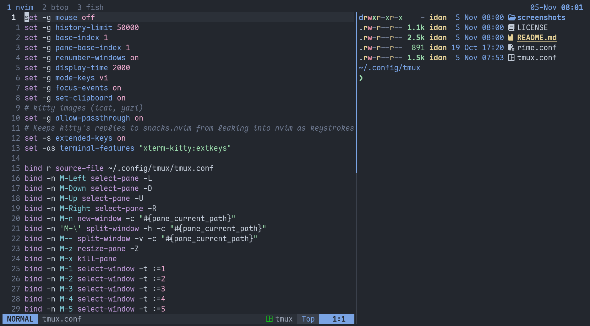

# dots, w0x7y special

my configs in one repo. [rime](https://github.com/w0x7y/rime) colors in all of them



ghostty, tmux and nvim together

### install

```sh
git clone https://github.com/w0x7y/w0x7y.dots
cp -r w0x7y.dots/{nvim,vis,ghostty,tmux} ~/.config/
```

copy only the folders you want. each one's readme lists what it needs

### what's in it

~ [nvim](nvim/), neovim with one file per feature, lsp, completion and revo support\
~ [vis](vis/), vis with lsp, format on save, git signs and revo\
~ [ghostty](ghostty/), maple mono and a see-through background\
~ [tmux](tmux/), a plain bar on top and alt keys that skip the prefix

### layout

```text
nvim/      neovim
vis/       vis
ghostty/   ghostty
tmux/      tmux
LICENSE    mit, for everything but the vis plugins below
```

vis-lspc, vis-modal, vis-autoclose and vis-colorizer in `vis/plugins/` come from other people and keep their own licenses

_license: [mit](./LICENSE)_
