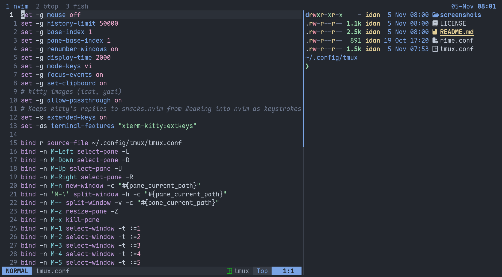

# tmux, w0x7y special

my tmux config. [rime](https://github.com/w0x7y/rime) colors, a plain bar on top and alt keys that skip the prefix



nvim beside a shell. the blue window on the bar is the current one

### install

needs tmux `3.3`+, and a nerd font for the zoom icon

```sh
git clone https://github.com/w0x7y/w0x7y.dots
cp -r w0x7y.dots/tmux ~/.config/
tmux
```

tmux finds `~/.config/tmux/tmux.conf` on its own, and `prefix r` reloads it

### keys

alt keys work without the prefix. the prefix is tmux's default, `C-b`

| key                  | does                                |
| -------------------- | ----------------------------------- |
| `alt+arrows`         | move to the pane in that direction  |
| `alt+\`              | split side by side                  |
| `alt+-`              | split top and bottom                |
| `alt+n`              | new window                          |
| `alt+z`              | zoom the pane, its tab gets `󰊓`     |
| `alt+x`              | close the pane, without asking      |
| `alt+1` to `alt+9`   | go to that window                   |
| `prefix r`           | reload the config                   |

splits and new windows from alt keys open in the current pane's directory\
the mouse is off, so `prefix [` scrolls back. copy mode uses vi keys

### what's in it

~ the bar sits on top, with windows on the left and the date and time on the right. no session name and no boxes\
~ the current window's name turns blue, the rest stay gray, and a window that rings the bell turns pink\
~ windows and panes count from 1, and windows renumber when one closes\
~ 50000 lines of scrollback. messages stay up for 2 seconds\
~ programs inside can set the system clipboard through tmux with OSC 52\
~ kitty's image protocol passes through, for `kitten icat` and yazi previews\
~ focus events reach programs inside, so nvim knows when you switch away and back\
~ extended keys in kitty. snacks.nvim then asks tmux for the terminal's name instead of asking kitty, whose reply would leak into nvim as keystrokes\
~ `rime.conf` is rime's tmux port, unedited. `tmux.conf` changes the bar after loading it, so a newer `rime.conf` drops right in

### layout

```text
tmux.conf      options, keys, then the bar on top of rime
rime.conf      rime's tmux colors, unedited
screenshots/   the picture in this README
```

_license: [mit](../LICENSE)_
