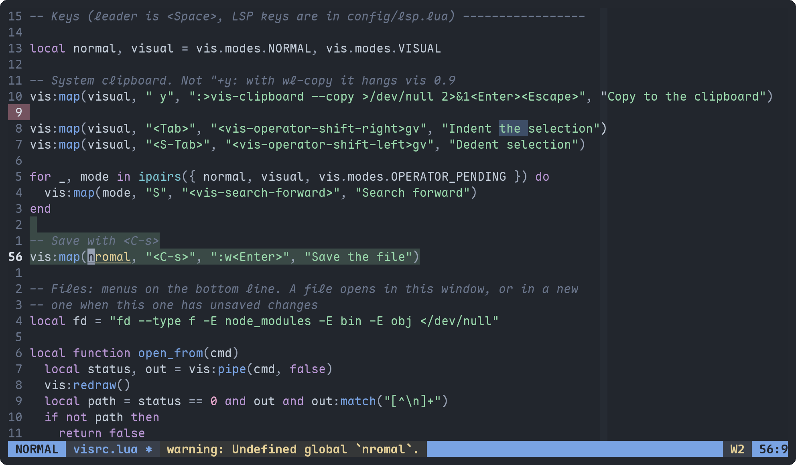
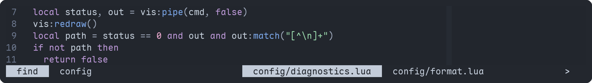
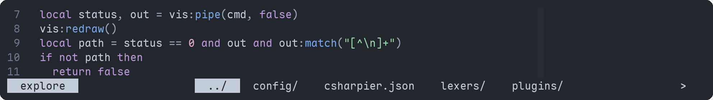
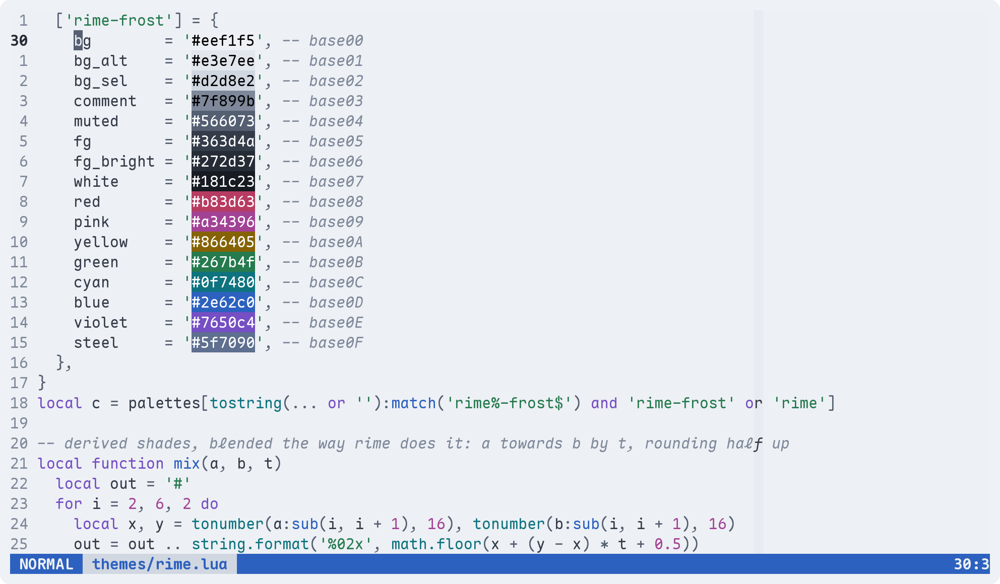

# vis, w0x7y special

my [vis](https://github.com/martanne/vis) config. [rime](https://github.com/w0x7y/rime) colors, lsp and [revo](https://github.com/if-not-nil/revo) support



a removed line, a changed word and two new lines since the git index, and the cursor line's warning on the status line

### install

needs vis `0.9` or a later git build, `git`, `fd` and `fzf`

```sh
git clone https://github.com/w0x7y/w0x7y.vis ~/.config/vis
```

language servers and formatters run from `$PATH`

### keys

leader is `<space>`

| key                       | does                                          |
| ------------------------- | --------------------------------------------- |
| `<leader>ff`              | find files, `:find foo` opens the best match  |
| `<leader>e`               | file explorer                                 |
| `<leader>y` / `<leader>p` | copy the selection / paste, system clipboard  |
| `<Tab>` / `<S-Tab>`       | indent / dedent the selection                 |
| `S`                       | search                                        |
| `gd` / `<C-t>`            | go to definition / back                       |
| `grn`                     | rename                                        |
| `]d` / `[d`               | next / previous diagnostic                    |
| `<C-space>`               | lsp completion, in insert mode                |

menus open on the bottom line, `esc esc` or `<C-c>` closes them\
no `K`: the status line shows the cursor line's problem, and hover is `:lspc-hover`






`<leader>ff`, `<leader>e` and `<C-space>` on the bottom line

### what's in it

~ rime or rime-frost, whichever `~/.local/state/rime/variant` says at startup\
~ relative line numbers, the cursor line shows its own\
~ format on save with stylua, clang-format, ruff, rustfmt, csharpier, prettier, zig fmt and revofmt, all at 2 spaces, and goimports (or gofmt) for Go, which indents with tabs\
~ diagnostics underline the problem in its color: red error, yellow warning, blue info, cyan hint\
~ git signs against the index, updated as you type: added lines and changed words get a tint, text removed from a line a red cell, and the line below removed lines a red number. the index is read on open and save, so a `git add` from a shell shows after the next save\
~ vis-lspc, vis-modal, vis-autoclose and vis-colorizer, copied into `plugins/`, their fixes marked `Local patch`. vis-gitsigns is our own, and so is `plugins/style-compat.lua`, which picks the style calls for vis 0.9 or a later build

the status line: mode, file, the cursor line's problem, the file's totals and line:col

```text
 NORMAL  open.lua  warning: Undefined global `nme`.          W1 H4  9:3
```



rime-frost, with vis-colorizer showing its palette in color

### layout

```text
visrc.lua               options, plugins and keys
config/lsp.lua          language servers and lsp keys
config/format.lua       format on save
config/diagnostics.lua  diagnostics on the status line
csharpier.json          csharpier's 2 space indent
themes/                 rime and rime-frost
lexers/revo.lua         revo highlighting
plugins/                vis-lspc, vis-modal, vis-autoclose, vis-colorizer, vis-gitsigns, style-compat.lua
screenshots/            the pictures in this README
```
